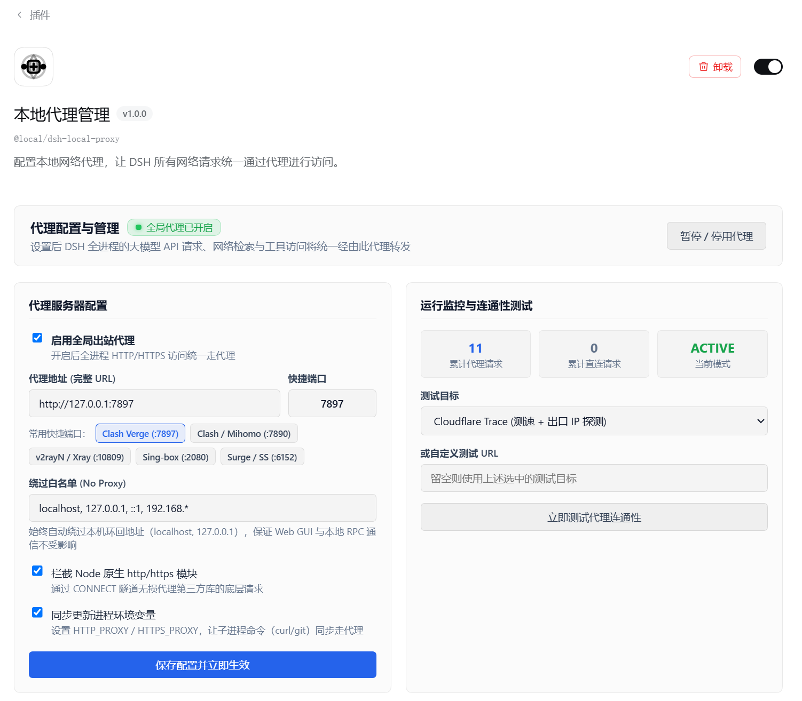

# dsh-local-proxy

> **本地网络代理管理插件 (Local Proxy Plugin for DeepSeek Harness)**  
> 统一接管 DSH 的全站网络出站请求，让大模型 API 推理、网页检索抓取与第三方工具调用等所有外部请求统一通过配置的本地代理访问。

---

## ✨ 核心特性

- 🌐 **Undici 全局调度器注入 (Global Dispatcher)**：深度接管 Node.js 18+ 原生 `fetch()`，让大模型 API、网络搜索、外网抓取全量走代理。
- 🛡️ **Node 原生 `http`/`https` CONNECT 隧道拦截**：透明代理传统三方客户端库通过 `http.request` / `https.request` 发起的底层请求。
- 🔄 **进程环境变量双向同步**：自动维护 `HTTP_PROXY`、`HTTPS_PROXY`、`ALL_PROXY`、`NO_PROXY` 及其小写别名，确保 DSH 派生的子进程（curl/git 等）同样继承代理。
- 🔒 **智能环回直连保护 (Bypass)**：默认强制绕过本机环回地址（`localhost`, `127.0.0.1`, `::1` 等），保障 DSH Web GUI 与本地 RPC 通信绝不受代理中断影响。
- ⚡ **一键连通性测试与公网出口 IP 探测**：在面板中支持实时对 Cloudflare、DeepSeek 官方 API 等进行连通性测试，实时回显往返延迟与检测到的公网出口 IP。
- 🎨 **无缝嵌入插件详情页**：完美融合 DSH 浅色/深色主题，内置常用代理客户端（Clash Verge、Clash / Mihomo、v2rayN、Sing-box 等）一键快捷填充。

---

## 配置截图



---

## 📦 安装方式

### 方式 1：通过 DSH 客户端界面安装（推荐）
1. 打开 DeepSeek Harness 客户端，点击左侧导航栏的 **「插件」**；
2. 点击右上角 **「添加插件」**；
3. 在地址栏中直接填入本仓库的 GitHub 标识：
   ```text
   github:saithink/dsh-local-proxy
   ```
   *（或者填写完整 Git 地址：`https://github.com/saithink/dsh-local-proxy.git`）*
4. 点击 **安装** 即可。

### 方式 2：通过 DSH 命令行安装
在终端中执行：
```bash
dsh plugin install github:saithink/dsh-local-proxy
```

---

## 🛠️ 使用指南

1. 打开 DSH 左侧 **「插件」**，找到 **「本地代理管理」** 并点击进入详情页；
2. 在 **「代理服务器配置」** 中：
   - 勾选 **启用全局出站代理**；
   - 点击常用快捷端口（例如 `Clash Verge (:7897)`）或在「快捷端口」框中直接输入端口号；
   - 点击 **「立即测试代理连通性」** 验证代理是否通畅及出口公网 IP；
   - 点击 **「保存配置并立即生效」**，DSH 全局出站代理即刻热重载生效！

---

## 📄 开源许可

[MIT License](LICENSE)
